# 🧠 RAG and Vector Databases

**✨ Complete Developer Study Notes**  
📚 Concepts · 🏗️ Architecture · 💻 Practical Examples · 🚀 Projects · 🎯 Interview Preparation

> 💡 **About these notes:** These notes are organized from the supplied handwritten study material. Code examples are illustrative and may require dependency/import updates for current library versions.

## 🗺️ Contents

1. [Introduction to RAG and Vector DB](#1-introduction-to-rag-and-vector-db)
2. [RAG Architecture and Workflow](#2-rag-architecture-and-workflow)
3. [Document Ingestion and Data Sources](#3-document-ingestion-and-data-sources)
4. [Text Chunking and Preprocessing](#4-text-chunking-and-preprocessing)
5. [Embeddings and Embedding Models](#5-embeddings-and-embedding-models)
6. [Vector Databases in RAG](#6-vector-databases-in-rag)
7. [Retrieval in RAG](#7-retrieval-in-rag)
8. [Building a RAG Pipeline with LangChain](#8-building-a-rag-pipeline-with-langchain)
9. [Chunking Strategies in RAG](#9-chunking-strategies-in-rag)
10. [Embeddings in RAG](#10-embeddings-in-rag)
11. [Vector Database Concepts](#11-vector-database-concepts)
12. [Chroma DB in RAG](#12-chroma-db-in-rag)
13. [Evaluation Metrics for RAG Systems](#13-evaluation-metrics-for-rag-systems)
14. [Optimizing RAG](#14-optimizing-rag)
15. [Real-World RAG Projects](#15-real-world-rag-projects)
16. [Deployment and Scalability](#16-deployment-and-scalability)
17. [Best Practices and Troubleshooting](#17-best-practices-and-troubleshooting)
18. [Interview Questions](#18-interview-questions)
19. [Summary and Next Steps](#19-summary-and-next-steps)

---

## 🧠 1. Introduction to RAG and Vector DB

### 📌 What is RAG?

**Retrieval-Augmented Generation (RAG)** combines information retrieval with a large language model (LLM). It retrieves relevant information from external knowledge sources and supplies that information as context for answer generation. RAG can reduce hallucinations and enable responses based on private, domain-specific, or recently updated data.

### 📌 Why RAG?

- LLM training data may be outdated or lack domain-specific knowledge.
- External sources can include PDFs, websites, databases, and APIs.
- Retrieval can improve relevance, traceability, and answer quality.
- Typical applications include enterprise assistants, documentation bots, and customer support.

### 🏛️ High-level RAG architecture

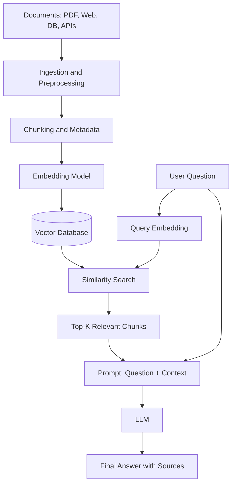

### 🗄️ What is a vector database?

A **vector database** stores, indexes, and searches vector embeddings efficiently, making semantic similarity search possible. Examples: FAISS, Chroma, Pinecone, Weaviate, Qdrant, and Milvus.

| Aspect | Traditional LLM | RAG with Vector DB |
|---|---|---|
| Knowledge | Pretrained parameters | Pretrained parameters plus retrieved data |
| Freshness | Limited by training | Can use updated sources |
| Domain data | Not automatically available | Can retrieve private/domain documents |
| Hallucinations | Possible | Can be reduced, not eliminated |
| Typical use | General Q&A | Grounded document and enterprise Q&A |

## 🏗️ 2. RAG Architecture and Workflow

RAG has two main paths: **indexing** (prepare documents) and **query-time retrieval/generation** (answer a question).

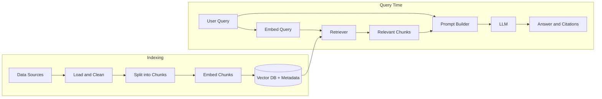

### 🔄 Workflow

1. Load documents from PDF, web, databases, or APIs.
2. Clean and split documents into smaller chunks.
3. Create embeddings for each chunk.
4. Store vectors and metadata in the vector database.
5. Embed the user's query using a compatible embedding model.
6. Retrieve the top-K relevant chunks.
7. Combine the question and retrieved context into a prompt.
8. Generate an answer with the LLM.
9. Return the answer, optionally with source references.

| Component | Purpose |
|---|---|
| Data ingestion | Read source documents |
| Chunking | Split large documents into manageable units |
| Embedding model | Map text to numerical vectors |
| Vector DB | Index and search embeddings |
| Retriever | Select relevant context |
| Prompt builder | Assemble question and context |
| LLM | Generate the answer |

## 📥 3. Document Ingestion and Data Sources

### 📚 Supported sources

PDFs, websites, MySQL/PostgreSQL/MongoDB, REST APIs, TXT/MD/CSV/JSON, S3/Google Drive, Confluence, Notion, and SharePoint.

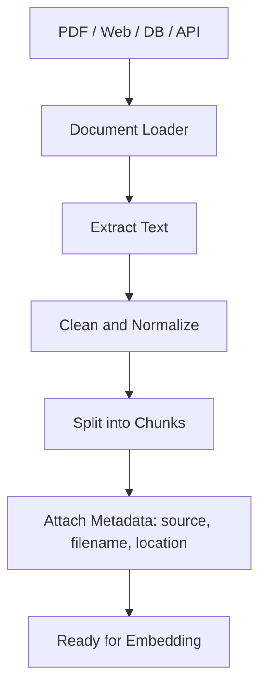

| Loader | Typical purpose |
|---|---|
| `PyPDFLoader` | Read PDF pages |
| `WebBaseLoader` | Load web content |
| `DirectoryLoader` | Read files in a folder |
| `CSVLoader` | Load CSV rows |
| `UnstructuredFileLoader` | Handle assorted file types |
| `NotionLoader` | Read Notion pages |
| `ConfluenceLoader` | Read Confluence content |

### 💻 PDF loading example

```python
from langchain_community.document_loaders import PyPDFLoader

loader = PyPDFLoader("sample.pdf")
documents = loader.load()

print(f"Total pages: {len(documents)}")
print(documents[0].page_content[:200])

for doc in documents:
    print(doc.metadata)
```

Metadata may contain the source path and page index. Exact fields depend on the loader/version.

## ✂️ 4. Text Chunking and Preprocessing

### 🧩 Why chunk?

Large documents exceed practical retrieval and context limits. Chunking improves retrieval granularity, controls token usage, and preserves relevant sections. Overlap helps retain context across chunk boundaries.

| Strategy | Description | Best use |
|---|---|---|
| Fixed-size | Split by character count | Simple text |
| Recursive | Prefer paragraph, line, and word boundaries | General structured documents |
| Token-based | Split by token count | Model context budgeting |
| Semantic | Split according to meaning | Technical/long documents |
| Sliding window | Overlapping consecutive chunks | Preserve boundary context |

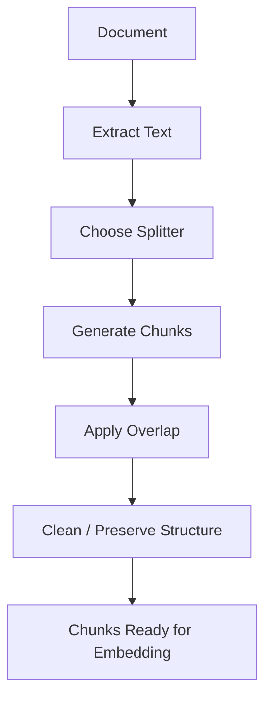

```python
from langchain_text_splitters import RecursiveCharacterTextSplitter

text_splitter = RecursiveCharacterTextSplitter(
    chunk_size=500,
    chunk_overlap=50,
    separators=["\n\n", "\n", " ", ""]
)
chunks = text_splitter.split_text(text)
print(f"Total chunks: {len(chunks)}")
print(chunks[0])
```

**Preprocessing:** remove noise and unnecessary whitespace, handle headers/footers and page numbers, retain meaningful headings/tables, and normalize text only when appropriate. Useful tools include LangChain text splitters, Unstructured, tiktoken, spaCy, and NLTK.

## 🔢 5. Embeddings and Embedding Models

An **embedding** is a dense numerical vector representing the semantic content of text (or other media). Similar meanings often map to nearby vectors.

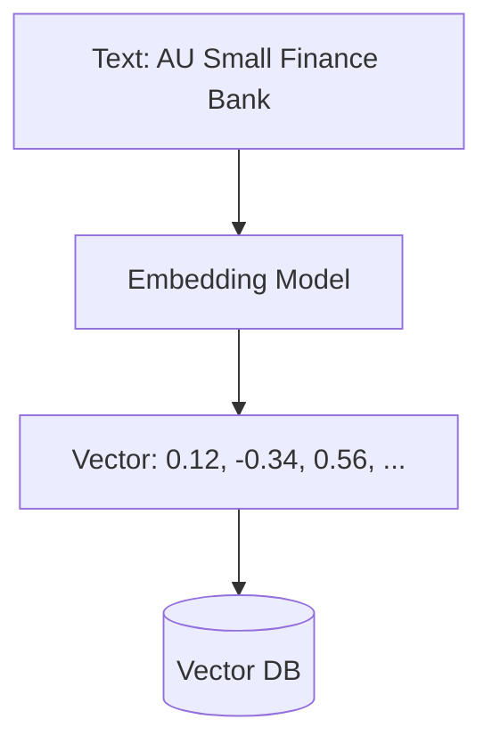

| Model | Provider | Typical dimensions | Notes |
|---|---|---:|---|
| `text-embedding-3-small` | OpenAI | 1536 | General-purpose |
| `text-embedding-3-large` | OpenAI | 3072 | Higher-capacity |
| `all-MiniLM-L6-v2` | SentenceTransformers | 384 | Lightweight |
| `bge-base-en` | BAAI | 768 | Open-source retrieval |
| `e5-base` | Microsoft | 768 | Retrieval-oriented |
| `nomic-embed-text` | Nomic | 768 | Open-source |

```python
from langchain_openai import OpenAIEmbeddings

embeddings = OpenAIEmbeddings(model="text-embedding-3-small")
vector = embeddings.embed_query("This is a sample document about banking.")
print(len(vector))
print(vector[:5])
```

Use compatible embeddings for document indexing and query search. Embedding quality directly affects retrieval quality.

## 🗄️ 6. Vector Databases in RAG

Vector databases support high-dimensional vector indexing, nearest-neighbor search, and often metadata filters.

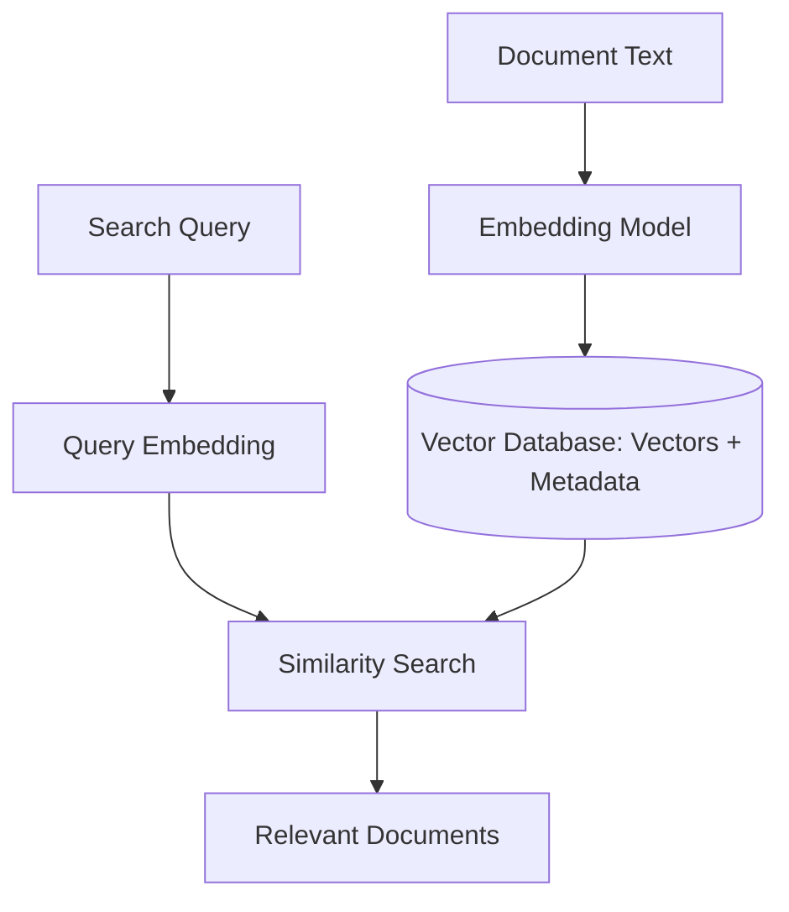

| Database | Type | Strength | Typical use |
|---|---|---|---|
| FAISS | Vector search library | Fast local indexes | Research/local search |
| Chroma | Vector database | Easy local persistence | Prototypes and RAG |
| Pinecone | Managed service | Cloud scaling | Production |
| Weaviate | Vector database | Hybrid retrieval | Enterprise search |
| Qdrant | Vector database | Payload/metadata filters | Production |
| Milvus | Distributed vector database | Large-scale indexing | Enterprise |
| Astra DB | Managed database | Cloud integration | Hosted applications |

### 📏 Similarity metrics

**Cosine similarity:**

$$\operatorname{cosine}(A,B)=\frac{A\cdot B}{\lVert A\rVert\lVert B\rVert}$$

**Euclidean distance:**

$$d(A,B)=\sqrt{\sum_i(A_i-B_i)^2}$$

**Dot product:**

$$A\cdot B=\sum_i A_i B_i$$

Cosine compares direction, Euclidean measures distance, and dot product combines magnitude and alignment. For normalized vectors, dot product and cosine similarity coincide.

### 💻 Chroma example

```python
import chromadb

client = chromadb.PersistentClient(path="./chroma_db")
collection = client.get_or_create_collection(name="my_docs")
collection.add(
    documents=[
        "AU Small Finance Bank is an Indian bank",
        "It provides banking and financial services",
    ],
    ids=["doc1", "doc2"],
)
results = collection.query(query_texts=["banking services"], n_results=2)
print(results["documents"])
```

## 🔎 7. Retrieval in RAG

Retrieval embeds a question and finds the most similar stored document chunks, usually returning the top K candidates.

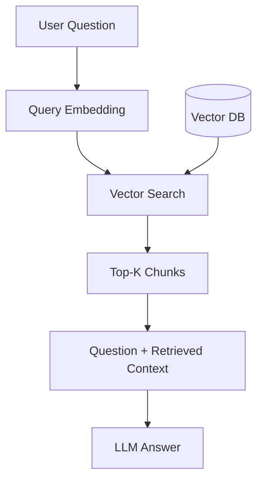

| Method | Description | When useful |
|---|---|---|
| Similarity search | Nearest vectors | General RAG |
| MMR | Balance relevance and diversity | Reduce redundant results |
| Hybrid search | Vector + keyword/BM25 | Exact terms and semantic meaning |
| Metadata filtering | Restrict by source/date/type | Domain and access constraints |

```python
from langchain_community.vectorstores import FAISS
from langchain_openai import OpenAIEmbeddings

embeddings = OpenAIEmbeddings()
# Load only a trusted, previously saved local index.
db = FAISS.load_local(
    "vector_db", embeddings, allow_dangerous_deserialization=True
)
results = db.similarity_search("How to open a savings account?", k=3)
for i, doc in enumerate(results, 1):
    print(f"Result {i}: {doc.page_content[:100]}")
    print("Source:", doc.metadata.get("source"))
```

> **Security:** The FAISS deserialization flag must only be used for an index you created or otherwise trust.

## 🔗 8. Building a RAG Pipeline with LangChain

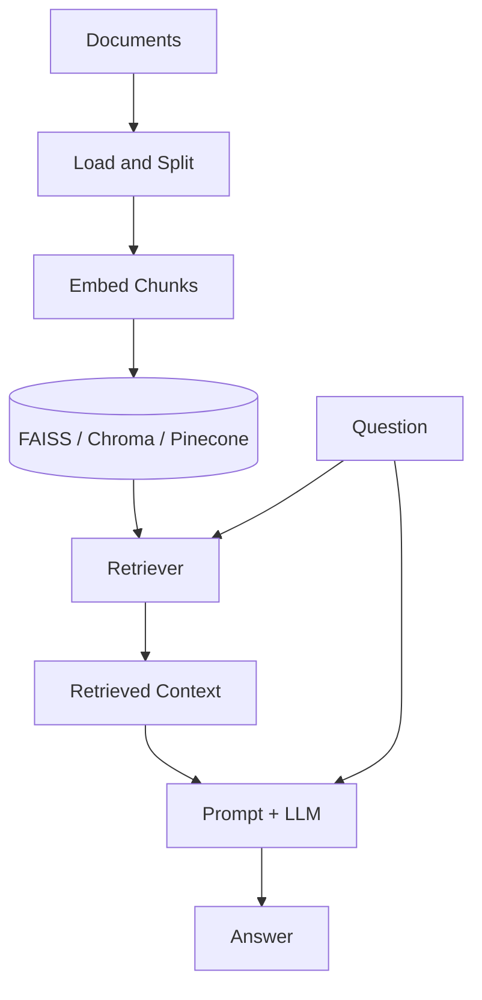

### 💻 End-to-end example: PDF → FAISS → LLM

```python
from langchain_community.document_loaders import PyPDFLoader
from langchain_text_splitters import RecursiveCharacterTextSplitter
from langchain_openai import OpenAIEmbeddings, ChatOpenAI
from langchain_community.vectorstores import FAISS
from langchain_core.prompts import ChatPromptTemplate

# 1. Load and split
pages = PyPDFLoader("au_bank_guide.pdf").load()
splitter = RecursiveCharacterTextSplitter(chunk_size=500, chunk_overlap=50)
chunks = splitter.split_documents(pages)

# 2. Embed and index
embeddings = OpenAIEmbeddings(model="text-embedding-3-small")
db = FAISS.from_documents(chunks, embeddings)

# 3. Retrieve relevant text
query = "Which KYC documents are required for a savings account?"
retrieved = db.similarity_search(query, k=3)
context = "\n\n".join(doc.page_content for doc in retrieved)

# 4. Prompt the LLM
prompt = ChatPromptTemplate.from_messages([
    ("system", "Answer using only the provided context. "
               "If the context does not contain the answer, say 'I don't know'."),
    ("human", "Context:\n{context}\n\nQuestion: {question}")
])
llm = ChatOpenAI(model="gpt-4o-mini", temperature=0)
answer = llm.invoke(prompt.format_messages(context=context, question=query))
print(answer.content)
```

The original notes use older `RetrievalQA`, `ChatOpenAI`, and LangChain import paths. This example uses a more modular prompt-and-retrieval pattern while retaining the same workflow.

## 🧩 9. Chunking Strategies in RAG

| Strategy | Pros | Cons | Suitable for |
|---|---|---|---|
| Fixed-size | Easy to implement | Can split sentences | Simple data |
| Recursive | Preserves boundaries | Requires tuning | General docs |
| Semantic | Meaningful boundaries | Additional embedding cost | Technical content |
| Token-based | Token budget control | May break structure | Strict context limits |
| Paragraph-based | Natural sections | Variable chunk sizes | Articles/blogs |

```python
from langchain_text_splitters import RecursiveCharacterTextSplitter

splitter = RecursiveCharacterTextSplitter(
    chunk_size=1000,
    chunk_overlap=200,
    separators=["\n\n", "\n", " ", ""],
)
chunks = splitter.split_text("Your document text here...")
print("Total chunks:", len(chunks))
```

**Practical starting points from the notes:** test 500–1000 characters per chunk and 10–20% overlap. These are heuristics, not universal settings; evaluate retrieval on your own documents.

## 📐 10. Embeddings in RAG

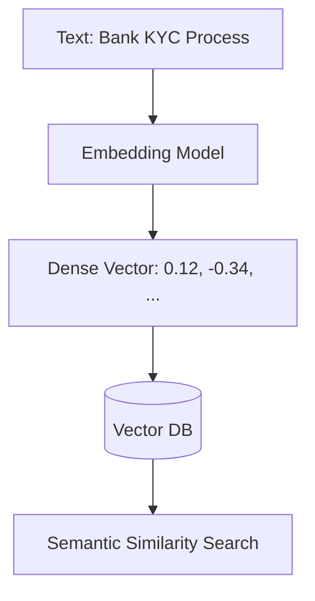

### 💻 SentenceTransformers example

```python
from sentence_transformers import SentenceTransformer

model = SentenceTransformer("all-MiniLM-L6-v2")
embedding = model.encode("AU Small Finance Bank KYC process")
print("Embedding dimension:", len(embedding))
print(embedding[:10])
```

### 💻 OpenAI API example

```python
from openai import OpenAI

client = OpenAI()  # Reads OPENAI_API_KEY from environment
response = client.embeddings.create(
    model="text-embedding-3-small",
    input="AU Small Finance Bank KYC process",
)
embedding = response.data[0].embedding
print(len(embedding))
```

### 📌 Conceptual vector-space diagram

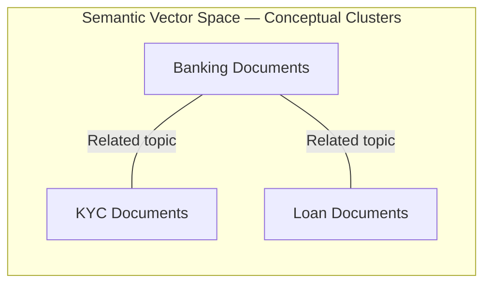

Documents with similar meaning tend to cluster in vector space. Actual embeddings have hundreds or thousands of dimensions; diagrams show simplified projections.

## ⚙️ 11. Vector Database Concepts

### ✨ Key features

- Store and index high-dimensional embeddings.
- Fast approximate nearest-neighbor (ANN) search.
- Metadata filtering.
- Scaling to large datasets.
- Semantic search, recommendation, and image retrieval.

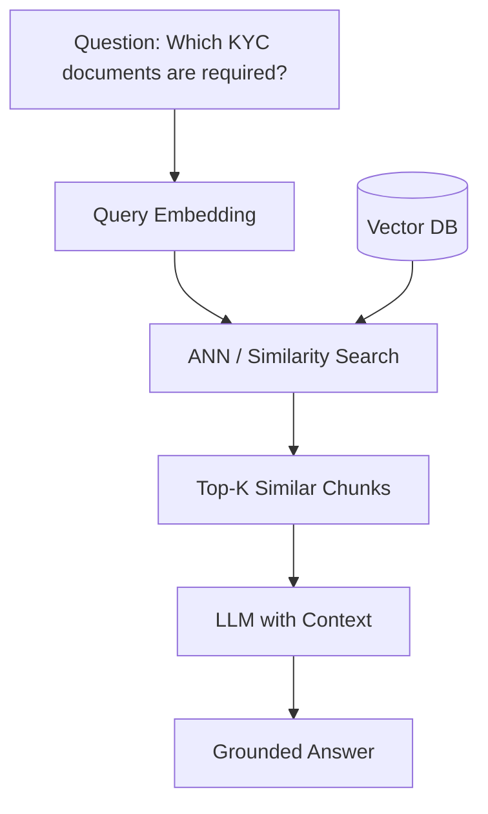

| Database | Notes |
|---|---|
| FAISS | Efficient library for vector indexing and search |
| Chroma | Easy local vector database with metadata |
| Pinecone | Managed cloud service |
| Qdrant | Filtering and vector search |
| Weaviate | Semantic and hybrid search |
| Milvus | Distributed large-scale vector search |

**Similarity:** cosine similarity, dot product, and Euclidean distance. Smaller Euclidean distance means closer vectors; larger cosine/dot scores generally mean closer matches under the appropriate normalization.

## 💾 12. Chroma DB in RAG

Chroma is an open-source vector database supporting persistence, metadata, and similarity search. It is commonly used for RAG prototypes and document assistants.

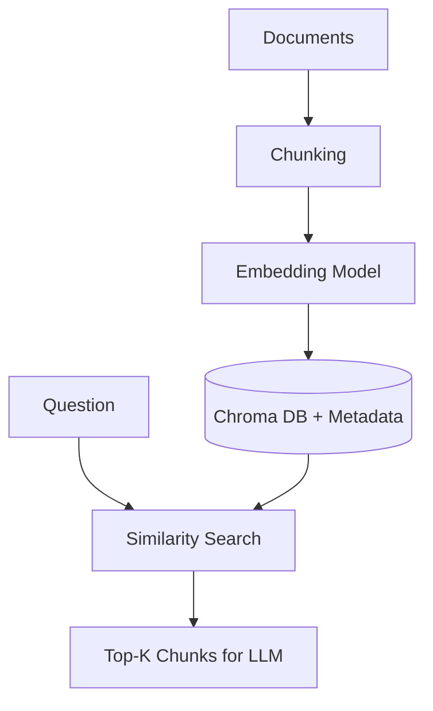

### 📌 Store documents

```python
from langchain_community.document_loaders import TextLoader
from langchain_text_splitters import RecursiveCharacterTextSplitter
from langchain_openai import OpenAIEmbeddings
from langchain_chroma import Chroma

loader = TextLoader("data.txt")
documents = loader.load()
chunks = RecursiveCharacterTextSplitter(
    chunk_size=500, chunk_overlap=100
).split_documents(documents)

embeddings = OpenAIEmbeddings()
db = Chroma.from_documents(
    documents=chunks,
    embedding=embeddings,
    persist_directory="./chroma_db",
)
```

### 📌 Query persisted documents

```python
from langchain_chroma import Chroma
from langchain_openai import OpenAIEmbeddings

db = Chroma(
    persist_directory="./chroma_db",
    embedding_function=OpenAIEmbeddings(),
)
results = db.similarity_search("What are the KYC documents required?", k=3)
for i, doc in enumerate(results, 1):
    print(f"Result {i}: {doc.page_content}")
    print("Metadata:", doc.metadata)
```

| Feature | Chroma | FAISS | Pinecone | Qdrant |
|---|---|---|---|---|
| Category | Vector DB | Vector search library | Managed cloud DB | Vector DB |
| Local development | Yes | Yes | Primarily hosted | Yes |
| Metadata support | Yes | Application-managed | Yes | Yes |
| Typical role | Prototypes / RAG | Local search | Hosted production | Filter-heavy production |

## 📊 13. Evaluation Metrics for RAG Systems

RAG evaluation covers retrieval, generation, end-to-end answer quality, and operational performance.

| Metric | Area | Meaning | Direction |
|---|---|---|---|
| Precision@K | Retrieval | Relevant results among K retrieved | Higher |
| Recall@K | Retrieval | Relevant results found among all relevant results | Higher |
| Hit Rate@K | Retrieval | Fraction of queries with ≥1 relevant result in top K | Higher |
| MRR | Retrieval | Mean reciprocal rank of first relevant result | Higher |
| Context precision | Retrieval/context | Relevance of retrieved context | Higher |
| Faithfulness | Generation | Answer grounded in context | Higher |
| Answer relevance | Generation | Response addresses question | Higher |
| BLEU / ROUGE | Generation | Text overlap with reference answer | Higher (context-dependent) |
| Latency | System | Time to answer | Lower |
| Cost/query | System | Retrieval + generation cost | Lower |
| User satisfaction | System | Human rating | Higher |

### 💻 Retrieval example

Question: **What is the KYC process?**

| Rank | Retrieved document | Relevant? |
|---:|---|---|
| 1 | KYC Guide.pdf | Yes |
| 2 | Account Opening.pdf | Yes |
| 3 | FD Policy.pdf | No |
| 4 | Loan Policy.pdf | No |
| 5 | KYC FAQ.pdf | Yes |

In this example, **Precision@5 = 3/5 = 0.6**. **Hit Rate@5 = 1** for this query because at least one relevant result appears. (The handwritten notes labeled 3/5 as Hit Rate; the distinction is clarified here.)

### 💻 Faithfulness example

**Retrieved context:** "KYC is completed online using Aadhaar, PAN and live video verification."

**Generated answer:** "KYC can be completed online using Aadhaar, PAN and video verification."

The answer is grounded in the context. Evaluate faithfulness and relevance on representative real-world questions, not only a single example.

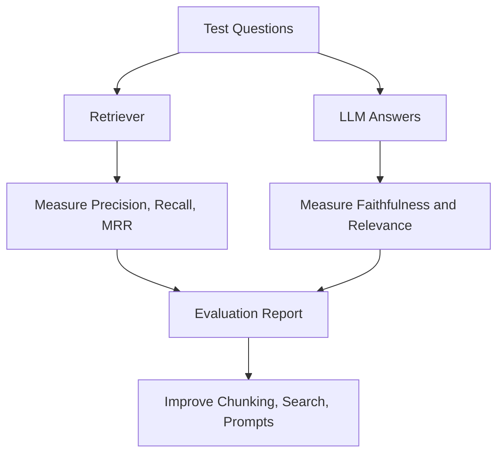

## 🚀 14. Optimizing RAG

### 📌 Optimization areas

| Area | Techniques | Benefit |
|---|---|---|
| Latency | Smaller models, ANN index tuning, streaming, async processing | Faster answers |
| Cost | Limit context, cache embeddings, efficient models | Lower API/compute usage |
| Caching | Cache answers and embeddings | Reuse prior computation |
| Prompts | Clear instructions, constraints, examples | Better grounding |
| Retrieval | Reranking, hybrid search, tuned chunking | More relevant context |

### ⚡ Cache flow

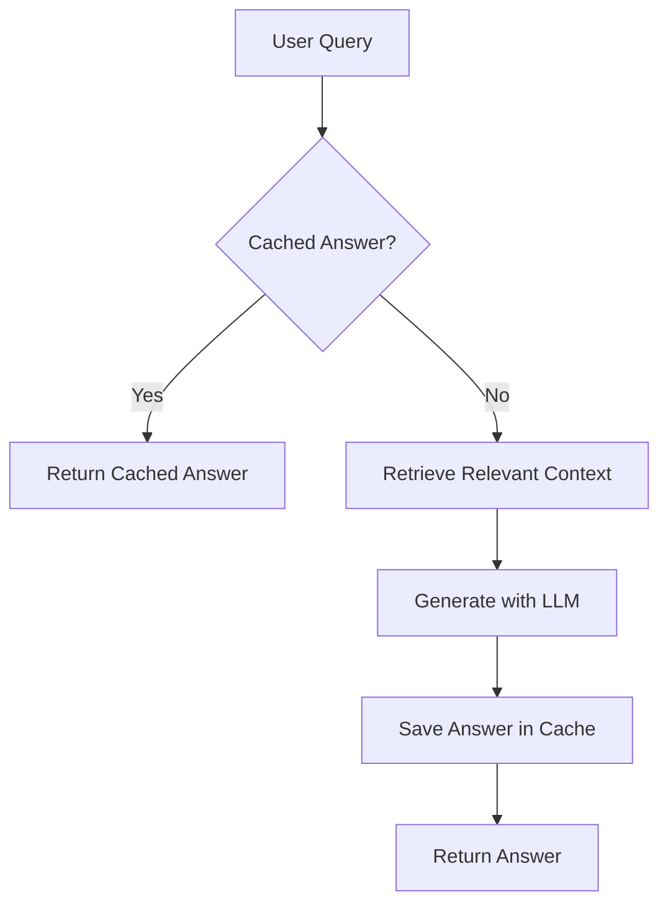

### ✍️ Grounded prompt template

```text
You are a helpful assistant. Use the following context to answer the question.
If the answer is not available in the context, say "I don't know".

Context:
{context}

Question:
{user_query}

Answer:
```

**Optimization tips:** test retrieval quality before increasing context size, avoid re-embedding unchanged documents, measure latency and token costs, and monitor answer quality after each change.

## 💬 15. Real-World RAG Projects

Example projects: **Chat with PDF**, **enterprise knowledge bot**, **internal documentation assistant**, and **customer support knowledge base**.

### 🏛️ Architecture

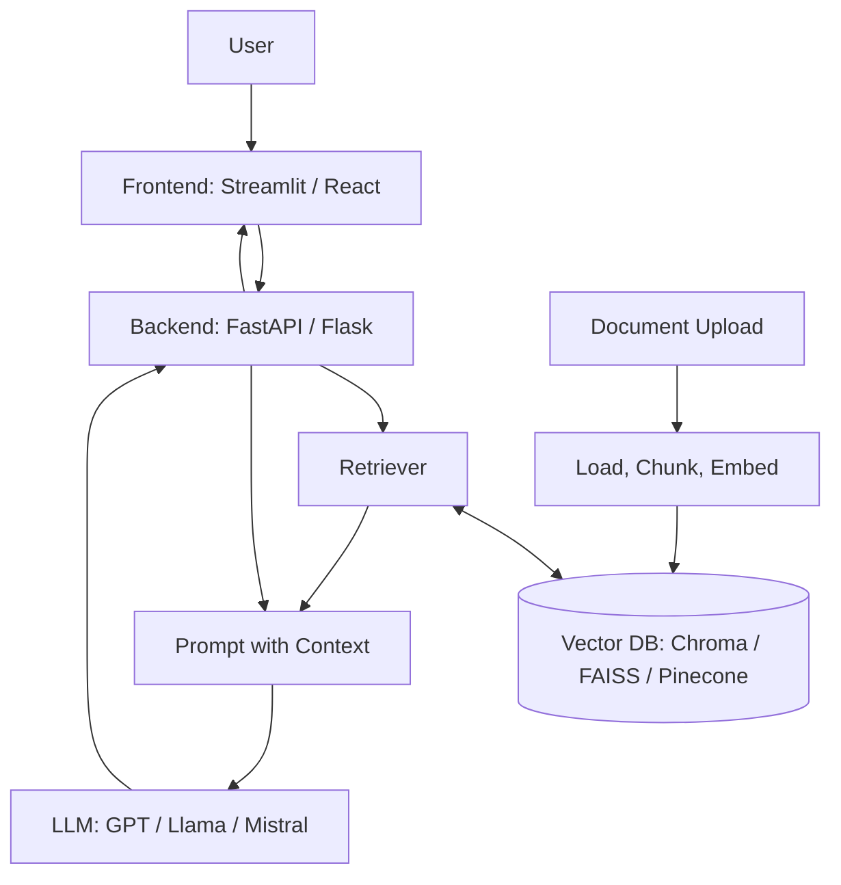

| Component | Options |
|---|---|
| Frontend | Streamlit, React, Next.js |
| Backend | FastAPI, Flask |
| Document parsing | PyPDF2, Unstructured, LangChain loaders |
| Chunking | RecursiveCharacterTextSplitter |
| Embeddings | OpenAI, SentenceTransformers |
| Vector DB | FAISS, Chroma, Pinecone, Qdrant |
| LLM | GPT, Llama, Mistral |
| Deployment | Docker, Kubernetes, AWS, GCP |

### 📌 PDF ingestion and storage

```python
from langchain_community.document_loaders import PyPDFLoader
from langchain_text_splitters import RecursiveCharacterTextSplitter
from langchain_openai import OpenAIEmbeddings
from langchain_chroma import Chroma

pages = PyPDFLoader("data/report.pdf").load()
chunks = RecursiveCharacterTextSplitter(
    chunk_size=500, chunk_overlap=100
).split_documents(pages)

vector_db = Chroma.from_documents(
    documents=chunks,
    embedding=OpenAIEmbeddings(),
    persist_directory="./chroma_db",
)
print("Documents stored successfully")
```

### 📌 Query the knowledge base

```python
from langchain_chroma import Chroma
from langchain_openai import OpenAIEmbeddings, ChatOpenAI
from langchain_core.prompts import ChatPromptTemplate

vector_db = Chroma(
    persist_directory="./chroma_db",
    embedding_function=OpenAIEmbeddings(),
)
query = "What is the KYC process?"
results = vector_db.similarity_search(query, k=3)
context = "\n\n".join(doc.page_content for doc in results)

prompt = ChatPromptTemplate.from_template(
    "Use only this context. If unknown, say 'I don't know'.\n"
    "Context: {context}\nQuestion: {question}"
)
answer = ChatOpenAI(model="gpt-4o-mini", temperature=0).invoke(
    prompt.format_messages(context=context, question=query)
)
print("Answer:", answer.content)
for doc in results:
    print("Source:", doc.metadata.get("source"), doc.metadata.get("page"))
```

For real deployments, add authentication, access checks before retrieval, citations, feedback, and logging.

## ☁️ 16. Deployment and Scalability

| Deployment | Best for | Pros | Limitations |
|---|---|---|---|
| Local | Development | Quick | Not scalable |
| Docker | Small/medium services | Portable | Containerization alone does not scale |
| Docker Compose | Local multi-service | Easy orchestration | Limited production orchestration |
| Kubernetes | Large production workloads | Scaling/self-healing | Operational complexity |
| AWS/GCP/Azure | Managed production | Hosted infrastructure | Cost and configuration |

### 🏛️ Deployment architecture

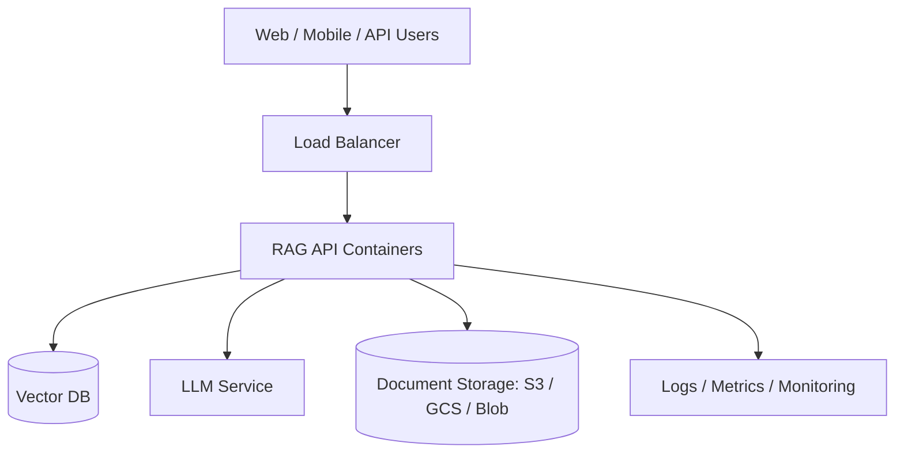

### 📌 Dockerfile

```dockerfile
FROM python:3.10-slim
WORKDIR /app
COPY requirements.txt .
RUN pip install --no-cache-dir -r requirements.txt
COPY . .
EXPOSE 8501
CMD ["streamlit", "run", "app.py", "--server.address=0.0.0.0"]
```

### 📌 Docker Compose

```yaml
services:
  app:
    build: .
    ports:
      - "8501:8501"
    depends_on:
      - chroma
  chroma:
    image: chromadb/chroma
    ports:
      - "8000:8000"
    volumes:
      - ./chroma_data:/chroma/chroma
```

### 🧭 Kubernetes overview

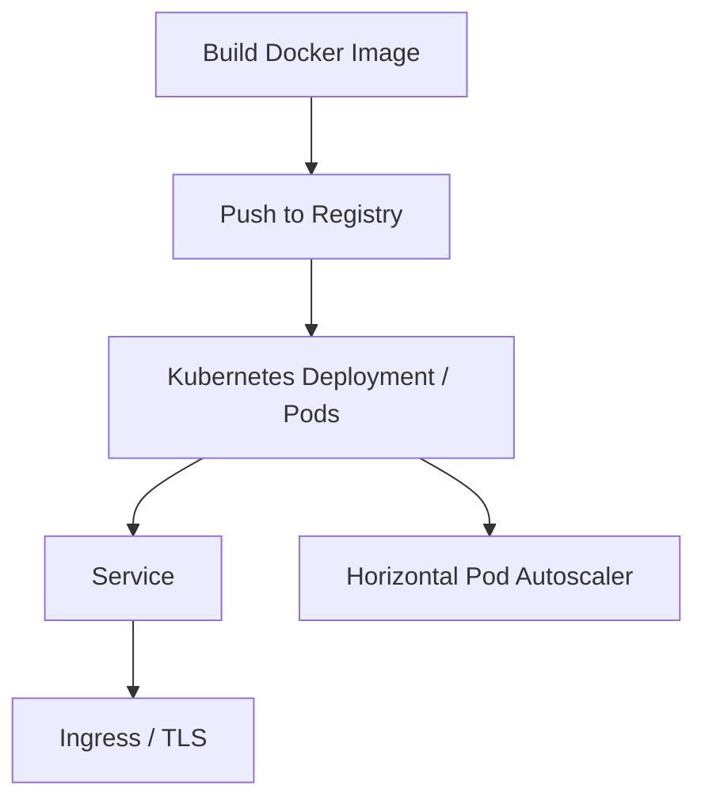

Use secret management, health checks, logging, resource limits, backups, and monitoring in production.

## 🛠️ 17. Best Practices and Troubleshooting

### ✅ Best practices by stage

| Stage | Recommendations |
|---|---|
| Ingestion | Trustworthy sources, cleaning, metadata |
| Chunking | Preserve structure and context, tune sizes |
| Embeddings | Consistent models, re-index on changes |
| Retrieval | Tune top-K, metadata filters, hybrid search, reranking |
| Generation | Grounded prompts, citations, fallback behavior |
| Operations | Caching, security, monitoring, evaluation |

### 📌 Common issues

| Issue | Likely cause | Solution |
|---|---|---|
| Irrelevant results | Weak chunks/data | Improve source quality and splitting |
| Low accuracy | Missing context / weak prompt | Improve retrieval and instructions |
| Slow responses | Model/DB/network latency | Cache, profile, tune indexes |
| High costs | Excess context or expensive models | Limit tokens and cache |
| Hallucinations | Insufficient evidence | Ground answers and provide citations |
| Vector DB errors | Wrong index/configuration | Check dimensions and settings |
| Deployment failures | Service misconfiguration | Inspect logs, secrets, resources |

### 🛠️ Troubleshooting commands

```bash
docker logs <container_id>
kubectl logs <pod-name>
```

### 📌 Debugging flow

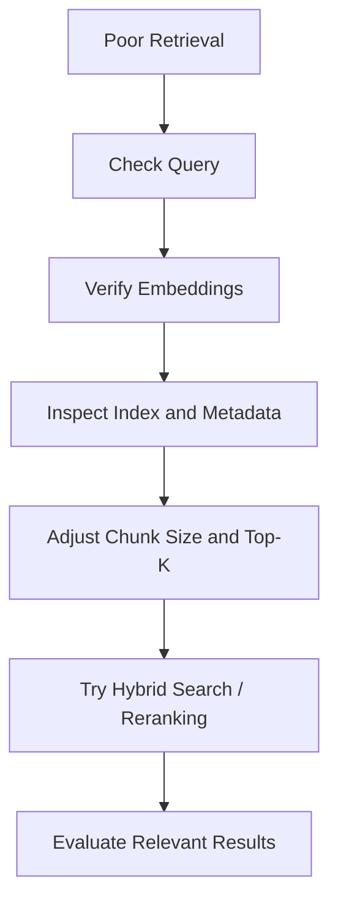

## 🎯 18. Interview Questions

| Question | Short answer |
|---|---|
| What is RAG? | Retrieval plus LLM generation grounded in external information. |
| Why a vector DB? | Efficient storage and similarity search over embeddings. |
| How does similarity search work? | Embed the query and find nearest stored vectors. |
| Common embedding models? | OpenAI embedding models, MiniLM, BGE, E5. |
| FAISS vs Chroma? | FAISS is a search library; Chroma is a database with persistence and metadata features. |
| How handle large documents? | Chunking, overlap, metadata, and retrieval tuning. |
| What is hybrid search? | Combine semantic vector search with keyword/BM25 search. |
| How reduce hallucinations? | Better retrieval, grounding, citations, and abstention when unsupported. |
| How evaluate RAG? | Precision, recall, MRR, faithfulness, relevance, latency, and cost. |
| How deploy RAG? | Containerize, monitor, and scale using cloud/Kubernetes where needed. |

### ❓ Scenario questions

| Scenario | Approach |
|---|---|
| Low accuracy | Check data, chunking, embeddings, filters, and prompts |
| Slow responses | Profile DB/model latency, cache, tune indexes |
| Domain-specific data | Ingest private sources and use metadata filters |
| Very large PDFs | Recursive/semantic splitting and indexed metadata |
| Real-time data | Integrate live APIs or database queries |
| Source citations | Store source metadata and return supporting references |

### 💻 Hands-on Chroma example

```python
from langchain_openai import OpenAIEmbeddings
from langchain_chroma import Chroma

embeddings = OpenAIEmbeddings()
db = Chroma.from_texts(
    ["AU Small Finance Bank provides banking services"],
    embedding=embeddings,
    persist_directory="./chroma_db",
)
results = db.similarity_search("What is the KYC process?", k=3)
for i, doc in enumerate(results, 1):
    print(i, doc.page_content, doc.metadata)
```

## ✅ 19. Summary and Next Steps

### 📌 Complete RAG recap

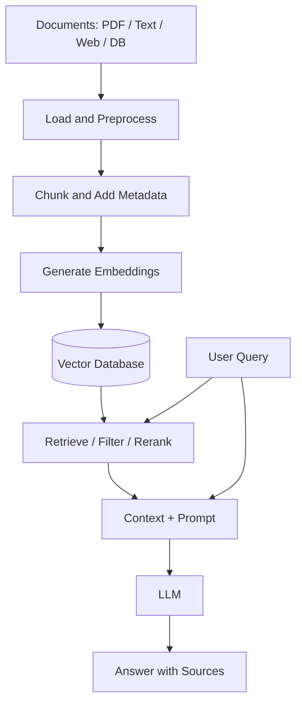

### 📌 Technology reference

| Component | Common options |
|---|---|
| Loaders | LangChain document loaders |
| Splitters | RecursiveCharacterTextSplitter |
| Embeddings | OpenAI, BGE, MiniLM |
| Vector DB | Chroma, FAISS, Pinecone, Qdrant, Weaviate |
| Frameworks | LangChain, LlamaIndex |
| LLMs | GPT, Llama, Mistral |
| Deployment | Docker, Kubernetes, AWS, GCP, Azure |
| UI / API | Streamlit, FastAPI, Flask |

### ✅ Best-practices checklist

- [ ] Use reliable, relevant source documents.
- [ ] Clean and preprocess while retaining important structure.
- [ ] Tune chunk size and overlap.
- [ ] Use consistent, suitable embedding models.
- [ ] Tune top-K, filters, and reranking.
- [ ] Cache safe-to-reuse computations.
- [ ] Monitor latency, cost, and quality.
- [ ] Enforce authentication and access controls.
- [ ] Evaluate on realistic questions regularly.

### ⚠️ Pitfalls to avoid

Poor-quality documents; inappropriate chunk sizes; missing metadata; mismatched embeddings; untuned retrieval; too much context; missing caching; weak monitoring; and insufficient evaluation.

### 📖 What to learn next

1. Build PDF chat, enterprise knowledge, and support bots.
2. Explore Graph RAG, Agentic RAG, and multimodal RAG.
3. Compare Pinecone, Qdrant, and Weaviate.
4. Learn LlamaIndex alongside LangChain.
5. Explore custom embeddings and fine-tuning.
6. Deploy with CI/CD, cloud services, and monitoring.
7. Add authentication, source permissions, and analytics.
8. Practice architecture, troubleshooting, and coding interviews.

---

**Note:** Mermaid diagrams render in Markdown viewers with Mermaid support (such as GitHub). Python samples require installing the corresponding packages and setting required API credentials. The content follows the uploaded notes while grouping repeated topics and removing cover attribution and pagination.
